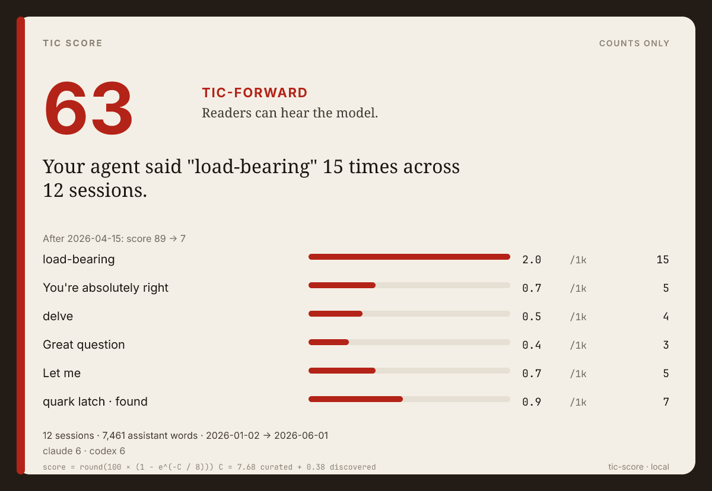

# tic-score

A local command that reads your coding agent's session logs, counts verbal tics, and prints a shareable score card. It also writes a snippet you can drop into `CLAUDE.md`, `AGENTS.md`, or a Claude Code skill so the agent stops using the phrases it actually overuses.

Nothing is uploaded. The package is MIT-licensed and **not published to npm**. Owner: [Kaung](https://github.com/KaungMyatNaing9).

```bash
npm install
npm test
node dist/cli.js --path fixtures --no-export
```

On your own machine, after `npm run build`:

```bash
node dist/cli.js
```

That scans Claude Code logs under `${CLAUDE_CONFIG_DIR:-~/.claude}/projects` and Codex CLI rollouts under `${CODEX_HOME:-~/.codex}/sessions` plus `archived_sessions`. Pass `--path` to point at a directory or a single `.jsonl` file instead. `--path` replaces the home directories. It does not add to them.

`npx tic-score` from the npm registry will not work, because this package has not been published. The verified offline path from a packed tarball is:

```bash
npm pack
npm install --offline ./tic-score-0.1.0.tgz
npx --offline --no-install tic-score --version
```

## Privacy

`--redact` is on unless you pass `--no-redact`.

- The terminal card, the PNG, and the SVG contain counts and the tic phrases only. They do not contain conversation text, file paths, session ids, or tool output.
- With the default, JSON and warnings are counts only. `--no-redact` adds the scanned log paths to JSON and warnings. It still does not print message text.
- There is no network client in `src/`. A unit test fails if one is imported.

## What counts

Only assistant prose.

| Dropped | Why |
| --- | --- |
| User messages | Not the agent's voice |
| Tool calls and tool results | Arguments and command output, including files the agent writes through a tool |
| Thinking and reasoning records | Not what the agent said to you |
| Codex developer / instruction messages | Setup, not a reply |
| Fenced code, indented code, unified diffs, numbered file views, and `<file>` style dumps | Quoted file contents and code |
| Claude Code `agent-aprompt_suggestion-*` files, `history.jsonl`, `session_index.jsonl` | Not transcripts |
| Codex `event_msg` copies of a reply | Kept only when no canonical assistant message already says the same thing |
| Abandoned Claude Code rewind branches | The latest leaf's ancestry is the session |

Short inline quotes are still counted. A one-line quotation of a file is not reliably separable from the agent's own sentence.

Rates are **hits per 1,000 assistant words**. A word is a letter-bearing token. `load-bearing` is one word. An em dash is not a word.

## Score

```
rate        = hits / assistant words × 1000
curated     = Σ (rate × weight) for every curated tic that occurred
discovered  = Σ min(rate, 15) × 0.4 for the top 5 phrases found off the list
C           = curated + discovered
score       = round(100 × (1 − e^(−C / 8)))
```

The card shows the largest contributors. The score still counts every curated tic, including ones that did not fit on the card. Discovered phrases are capped so one odd n-gram cannot outvote the catalog.

| Score | Band |
| --- | --- |
| 0–15 | Quiet |
| 16–35 | Noticeable |
| 36–55 | Chatty |
| 56–75 | Tic-forward |
| 76–100 | Catchphrase machine |

Weights live in `src/tics.ts` and are part of the formula. The em dash weight is 0.15 because a dash is punctuation: 20 dashes per 1,000 words adds 3.0 to C. `You're absolutely right` is 1.6. `load-bearing` is 1.5. `Furthermore` is 0.3. Overlapping phrases do not double-count: `Let me know` consumes the span, so it is not also `Let me`.

### Phrases that are not on the list

After the catalog matches are masked, tic-score counts 1–3 word sequences and compares them with Peter Norvig's Google n-gram counts (the top 8,000 alphabetic unigrams and 3,728 case-folded bigrams shipped in `src/baseline/table.ts`). A phrase is reported when it:

- is not only stopwords, and is not entirely programming vocabulary
- is a unigram only if it is hyphenated, missing from the English list, or a long `-ly` adverb
- is a bigram or trigram with at least two content words, and a trigram only if one of those words is rare
- clears a count floor, shows up in enough sessions, and is not concentrated in a single session
- is at least 8× the English baseline rate

With one session, discovery is noisier. A topic phrase can pass. The card marks off-list phrases with `found`.

## Compare

```bash
node dist/cli.js --compare 2026-04-15
```

A date with no time is UTC midnight. Messages before that instant are one score. Messages after it are another. Messages with no timestamp stay in the overall score and are left out of the comparison. Forked Codex sessions are not deduped against their parent, so a copied history can be counted twice. That limitation is in `ROADMAP.md`.

## Fix

```bash
node dist/cli.js fix
node dist/cli.js fix --write
node dist/cli.js fix --write --target claude
node dist/cli.js fix --write --global
```

Without `--write`, the snippet is printed and nothing is written. `--write` updates, in the current directory:

- `CLAUDE.md`
- `AGENTS.md`
- `.claude/skills/tic-score/SKILL.md`

`--global` also updates `~/.claude/CLAUDE.md`, `~/.codex/AGENTS.md`, and `~/.claude/skills/tic-score/SKILL.md`. Re-running replaces the block between `<!-- tic-score:start -->` and `<!-- tic-score:end -->`.

## Example

Generated from the synthetic fixtures in `fixtures/`. These are not real sessions. See `fixtures/SYNTHETIC.txt`.



The same run, plain terminal, width 64:

```
┌──────────────────────────────────────────────────────────────────┐
│ TIC SCORE                                                     63 │
│ Tic-forward                                                      │
│ Readers can hear the model.                                      │
│                                                                  │
│ Your agent said "load-bearing" 15 times across 12 sessions.      │
│                                                                  │
│ phrase                                 /1k  times                │
│ load-bearing             ##########    2.0     15                │
│ You're absolutely right  ###-------    0.7      5                │
│ delve                    ###-------    0.5      4                │
│ Great question           ##--------    0.4      3                │
│ Let me                   ###-------    0.7      5                │
│ * quark latch            #####-----    0.9      7                │
│ * found in your logs, not on the built-in list                   │
│                                                                  │
│ 12 sessions · 7,461 assistant words                              │
│ 2026-01-02 → 2026-06-01 · claude 6 · codex 6                     │
│ score = round(100 × (1 − e^(−C / 8)))                            │
│ C = 7.68 curated + 0.38 discovered                               │
│ Score counts every curated tic, not only the rows above.         │
│                                                                  │
│ After 2026-04-15: score 89 → 7                                   │
│ load-bearing                4.6 →    0.0  down 100%              │
│ You're absolutely right     1.5 →    0.0  down 100%              │
│ delve                       0.6 →    0.5  down 23%               │
│ Great question              0.9 →    0.0  down 100%              │
│ Let me                      1.5 →    0.0  down 100%              │
│ quark latch                 2.2 →    0.0  down 100%              │
│ 1 message had no timestamp and was left out of the comparison.   │
│                                                                  │
│ Counts and phrases only. No transcript text leaves this machine. │
└──────────────────────────────────────────────────────────────────┘
```

`quark latch` is planted in the fixtures so discovery has something to find. `zephyr widget` is planted in a single session and is not reported. The ordinary prose around them is there so the per-1,000-word rates are not a wall of tics.

## Measured speed

On the machine that ran the tests, in-process scans of `fixtures/` (51,959 bytes, 14 files, 7,461 assistant words):

| Run | Time |
| --- | --- |
| First scan, including the one-time baseline load | 57.8 ms |
| Mean of the next 20 scans | 11.9 ms |

That is not a measurement of a large real log directory. `npm run measure` prints the numbers again.

## Tests

`npm test` typechecks, lints is separate (`npm run lint`), and runs the unit, snapshot, end-to-end, and packed-tarball tests. The tarball test installs with `npm install --offline` and runs `npx --offline --no-install tic-score`.

Real `~/.claude` and `~/.codex` logs were not present on the machine that built this, so those paths are untested. Format notes, including what was checked against public sources and what is only defensive, are in [docs/LOG_FORMATS.md](docs/LOG_FORMATS.md).

## License

MIT. Copyright 2026 Kaung (https://github.com/KaungMyatNaing9).
